

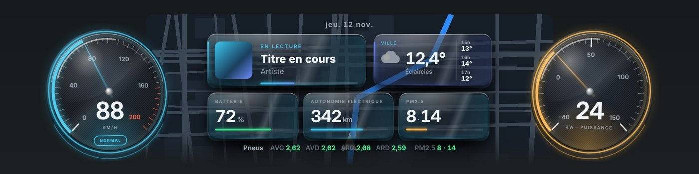

# V E K T R A

### لوحة عدادات BYD الخاصة بك، كما أردتها دائماً

سمات ثلاثية الأبعاد وتطبيقات وملاحة خلف المقود، ومساعد صوتي ومساعد قيادة للرادارات. تطبيق واحد، تمت تجربته على Sealion 7 وSeal وSeal U وSeal U DM-i.

  

[**⬇ تنزيل ملف APK**](https://giino01.github.io/Vektra/Vektra-2.6.1.apk) &nbsp;·&nbsp; [**🌐 الموقع**](https://giino01.github.io/Vektra/)

الإصدار 2.6.1 · 75.6 ميغابايت · صدرت في 12 نوفمبر 2026

[Français](README.md) · [English](README.en.md) · [Italiano](README.it.md) · [Deutsch](README.de.md) · [Português](README.pt.md) · [Türkçe](README.tr.md) · [Nederlands](README.nl.md) · [Español](README.es.md) · **العربية** · [中文](README.zh.md)

---

## التوافق — تمت تجربته واعتماده

يتكيف VEKTRA مع لوحة عدادات سيارتك BYD.

| الطراز | الحالة |
| --- | --- |
| **Sealion 7** | ✅ تمت تجربته واعتماده |
| **Seal** | ✅ تمت تجربته واعتماده |
| **Seal U** | ✅ تمت تجربته واعتماده |
| **Seal U DM-i** | ✅ تمت تجربته واعتماده |
| **طرازات أخرى** | ⏳ قيد التأكيد |

<table>
<tr>
<td width="50%" valign="top">

**SEAL · SEAL U · SEAL U DM-i** — اللوحة بالكامل

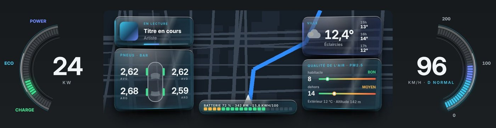

- **السمة بملء الشاشة** — السمة كاملة مع تطبيقك في الوسط
- **التطبيق بملء الشاشة** — Waze أو Google Maps أو Navigation Vektra على اللوحة كاملة
- الوقود والمدى في سيارات DM-i الهجينة

</td>
<td width="50%" valign="top">

**SEALION 7** — مصمم للوحة عداداتها

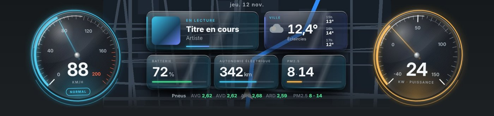

- **ملء الشاشة** — VEKTRA أسفل الشريط العلوي للسيارة
- **شاشة صغيرة** — نافذة على اليمين مع تطبيقك
- نسخة Sealion 7 من كل سمة
- سرعة السيارة وناقل الحركة والبطارية والإطارات والقدرة

</td>
</tr>
</table>

## السمات — 11 سمة، فاتحة وداكنة

طبّقها بلمسة واحدة، ثم انقل كل عنصر كما تريد في وضع التحرير.

<table>
<tr><td width="33%" valign="top"> <b>Carbone 3D+</b> عدادات ثلاثية الأبعاد تحت الزجاج</td><td width="33%" valign="top"> <b>VektraUI+</b> أقواس نيون</td><td width="33%" valign="top">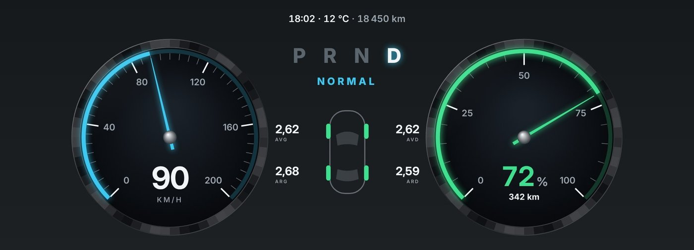 <b>الكرونوغراف</b> موانئ ساعة</td></tr>
<tr><td width="33%" valign="top">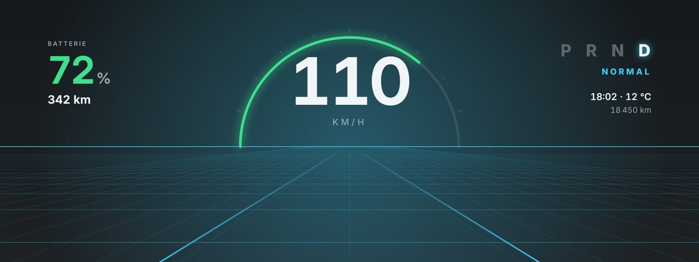 <b>الأفق</b> الطريق يتحرك مع سرعتك</td><td width="33%" valign="top">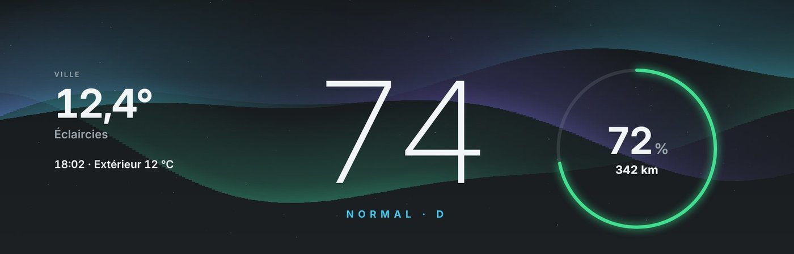 <b>الشفق</b> شفق قطبي متحرك</td><td width="33%" valign="top">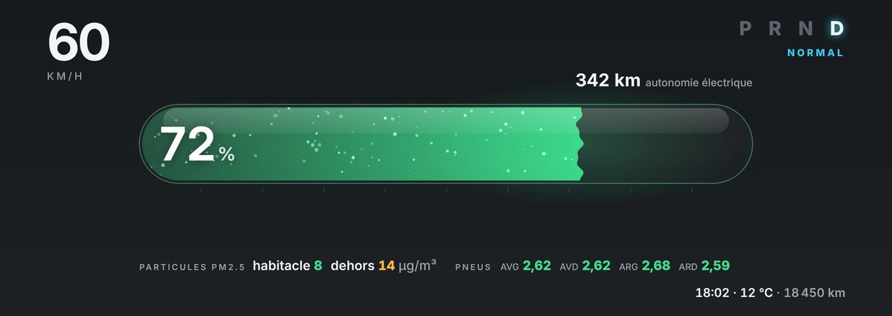 <b>الطاقة</b> بطارية في كبسولة بلازما</td></tr>
<tr><td width="33%" valign="top">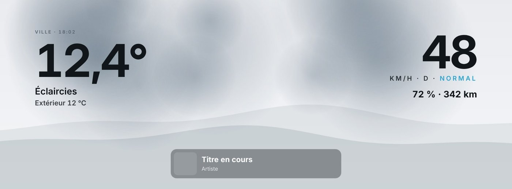 <b>السماء</b> الطقس الحقيقي في الخلفية</td><td width="33%" valign="top">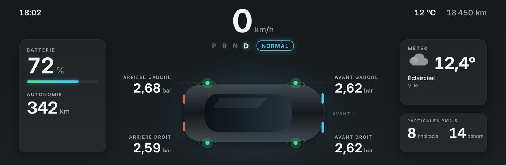 <b>الهيكل</b> ضغط كل إطار</td><td width="33%" valign="top">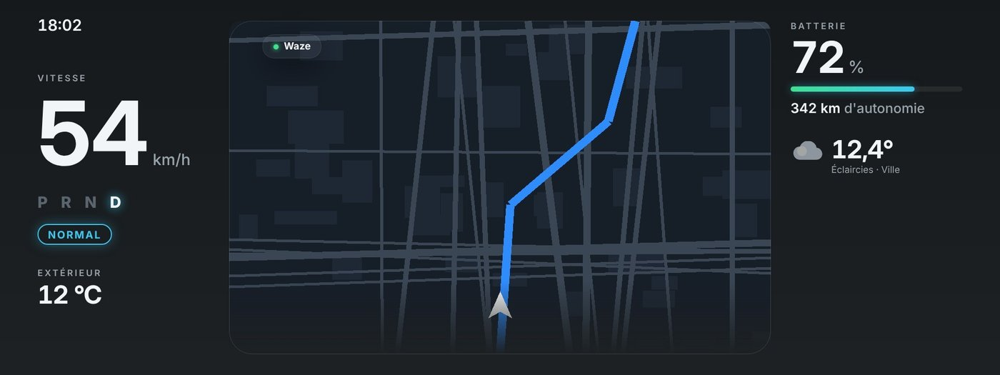 <b>خريطة</b> تطبيقك بحجم كبير</td></tr>
<tr><td width="33%" valign="top">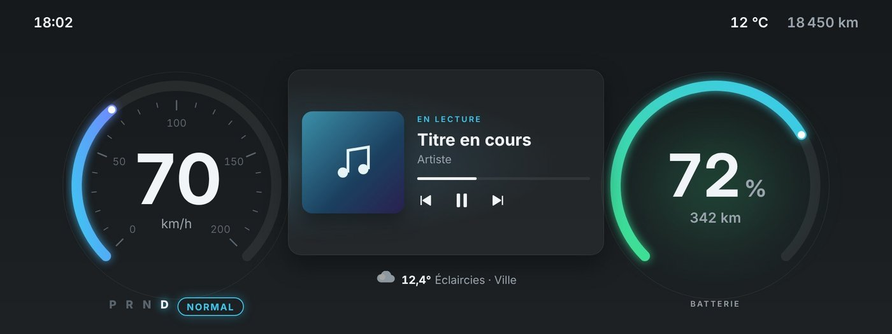 <b>Orbit</b> حلقات السرعة والبطارية</td><td width="33%" valign="top">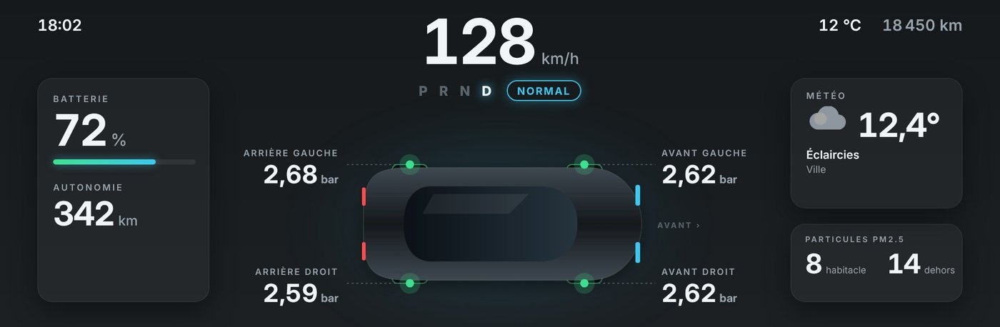 <b>رياضي</b> ألوان وضع القيادة</td></tr>
</table>

## التطبيقات

**Waze أو Google Maps أو خريطة Vektra خلف المقود**

<table>
<tr>
<td width="50%" valign="top">

**داخل السمة**

- Map وCarbone 3D+ وVektraUI+ تُبقي عداداتك حول التطبيق
- Navigation Vektra: خريطة Vektra في وسط اللوحة

</td>
<td width="50%" valign="top">

**التطبيق بملء الشاشة**

- يُعرض التطبيق وحده على اللوحة
- انقله وغيّر حجمه كما تريد في وضع التحرير
- حجم التطبيق والنص قابلان للضبط على اللوحة فقط: لا يتغير الجهاز اللوحي
- Sealion 7: أيضاً في الشاشة الصغيرة، في النافذة اليمنى

</td>
</tr>
</table>

## المساعد · الأوامر

**كل أوامر Vektra** — قل «Vektra» ثم طلبك. لا يُرسَل أي شيء مما تقوله إلى الإنترنت قبل كلمة «Vektra».

| الفئة | | أمثلة |
| --- | :---: | --- |
| **النوافذ** | 16 | «فيكترا، افتحي النوافذ» / «افتحي كل النوافذ» «فيكترا، أغلقي النوافذ» / «أغلقي كل النوافذ» «فيكترا، أغلقي كل شيء» / «أغلقي السيارة» |
| **السقف والستارة** | 9 | «فيكترا، افتحي فتحة السقف» «فيكترا، أغلقي فتحة السقف» «فيكترا، ارفعي فتحة السقف قليلاً» |
| **التكييف** | 15 | «فيكترا، شغّلي المكيّف» / «ضعي التكييف» «فيكترا، أطفئي المكيّف» «فيكترا، ضعي المكيّف على الوضع التلقائي» |
| **المقاعد والمقود** | 10 | «فيكترا، شغّلي تدفئة مقعدي» «فيكترا، شغّلي تدفئة مقعد الراكب» «فيكترا، شغّلي تدفئة المقعدين» |
| **الصندوق والمرايا والإضاءة** | 20 | «فيكترا، أديري الشاشة» / «لفّي الشاشة» «فيكترا، ضعي الشاشة عموديًا» / «ضعي الشاشة أفقيًا» «فيكترا، افتحي صندوق الأمتعة» |
| **القيادة والطاقة** | 21 | «فيكترا، انتقلي إلى النمط الرياضي» «فيكترا، فعّلي النمط الاقتصادي» «فيكترا، أعيدي النمط العادي» |
| **الموسيقى والصوت** | 7 | «فيكترا، المقطع التالي» / «الأغنية التالية» «فيكترا، المقطع السابق» «فيكترا، أوقفي الموسيقى مؤقتًا» / «أوقفي الموسيقى» |
| **اللوحة والسمات** | 12 | «فيكترا، ضعي سمة Carbon» «فيكترا، ضعي سمة Aston» «فيكترا، ضعي سمة VektraUI» |
| **التطبيقات** | 6 | «فيكترا، خذيني إلى الساحة الكبرى في بروكسل» «فيكترا، توجّهي إلى Charleroi» / «المسار إلى Namur» «فيكترا، أوقفي الملاحة» |

[**⬇ تنزيل القائمة الكاملة**](https://giino01.github.io/Vektra/commandes/VEKTRA_ASSISTANT_COMMANDES_ar.txt)

## مساعد القيادة — مساعدك في القيادة، يقظ دائماً

يمكن تفعيل كل تنبيه أو إيقافه من تبويب مساعد القيادة في التطبيق.

| الميزة | |
| --- | --- |
| **تنبيهات الرادارات وحركة المرور** | رادارات ثابتة ومتنقلة ومتوسط السرعة والإشارة الحمراء، وأشغال وازدحام. تنبيه قبل نحو 15 ثانية (300 أو 500 أو 1000 م حسب السرعة)، وتذكير عند الاقتراب، وصفارة عند تجاوز الرادار. |
| **قاعدة بيانات الرادارات** | تُحدّث تلقائياً كل أسبوع. |
| **أنواع التنبيهات** | حدّد التنبيهات التي تريد سماعها. |
| **التوجيه الصوتي لركن السيارة** | إعلان صوتي لمسافات الاقتراب أثناء الرجوع والمناورة · صوتي بنسبة 100% |
| **مراقبة البطارية والطاقة** | تنبيهات استباقية تحت 20% ونصائح للشحن في الطقس البارد |
| **تنبيه ضعف بطارية 12 فولت** | تنبّه فيكترا عندما يبقى جهد بطارية 12 فولت أقل من 11.8 فولت (إذا كانت السيارة توفّره). |
| **أمان الإطارات والطريق** | تنبيه هبوط ضغط الإطارات وخطر الجليد عند درجات حرارة تحت 3 مئوية |
| **تنبيه الاستراحة والنعاس** | اقتراح استراحة ودية بعد ساعتين من القيادة المتواصلة |
| **مطر ← تنبيه النوافذ** | يذكّرك Vektra بإغلاق النوافذ (مجرد تنبيه، دون طرح سؤال). |
| **تنبيه الضباب** | ينبّه عندما تشير حالة الطقس إلى ضباب في موقعك أثناء القيادة. مرة واحدة في كل رحلة. |
| **إعلان انقطاع الشبكة** | يخبرك عند انقطاع الشبكة وما يبقى ممكناً، ثم يعلن عودتها. |

[**⬇ تنزيل القائمة الكاملة**](https://giino01.github.io/Vektra/copilote/VEKTRA_COPILOTE_ar.txt)

## التثبيت — جاهز في 7 خطوات

| # | التثبيت |
| :---: | --- |
| **1** | **نزّل ملف APK** — حسب اختيارك: عبر متصفح الجهاز اللوحي، أو على وحدة USB، أو عبر Telegram على الجهاز اللوحي. |
| **2** | **ثبّت VEKTRA** — افتح الملف الذي نزّلته وأكّد التثبيت. |
| **3** | **امنح أذونات التطبيق** — وافق على كل إذن يُطلب عند الفتح الأول. |
| **4** | **امنح أذونات ADB** — وافق على طلب إذن ADB الذي يعرضه الجهاز اللوحي. |
| **5** | ⏱ **انتظر 30 ثانية** — بعد فتح VEKTRA أول مرة، اترك الجهاز اللوحي نحو 30 ثانية دون لمسه. |
| **6** | **أعد تشغيل الجهاز اللوحي** — إعادة تشغيل واحدة ويصبح كل شيء جاهزاً. |
| **7** | ✅ **اختر وابدأ** — في تبويب اللوحة: اختر طرازك ووضع العرض، ثم ابدأ العرض. تتم التحديثات بعد ذلك مباشرة داخل التطبيق. |

## التنزيل

### VEKTRA 2.6.1

بعشر لغات. تصل التحديثات بعد ذلك مباشرة إلى التطبيق.

[**⬇ تنزيل ملف APK**](https://giino01.github.io/Vektra/Vektra-2.6.1.apk)

75.6 ميغابايت · أندرويد 9 أو أحدث · BYD DiLink 3 · صدرت في 12 نوفمبر 2026

| الميزة | التنزيل |
| --- | --- |
| **أوامر المساعد** — القائمة الكاملة بلغتك. | [⬇ تنزيل](https://giino01.github.io/Vektra/commandes/VEKTRA_ASSISTANT_COMMANDES_ar.txt) |
| **ميزات مساعد القيادة** — كل التنبيهات وإعداداتها. | [⬇ تنزيل](https://giino01.github.io/Vektra/copilote/VEKTRA_COPILOTE_ar.txt) |
| **الموقع** | [🌐 https://giino01.github.io/Vektra/](https://giino01.github.io/Vektra/) |

### جديد في 2.6.1

- إصلاح (SEALION7): لا مزيد من الشريط الأسود أسفل شريط السيارة: تستخدم السمة والتطبيق نافذة العرض بالكامل.

---

**VEKTRA · تطبيق مستقل غير تابع لـ BYD**

مشروع شخصي، لا علاقة له بـ BYD. التثبيت والاستخدام على مسؤوليتك. المعلومات المعروضة تأتي من نظام السيارة وقد تكون غير دقيقة: لا تعتمد عليها أبدًا أثناء القيادة.

