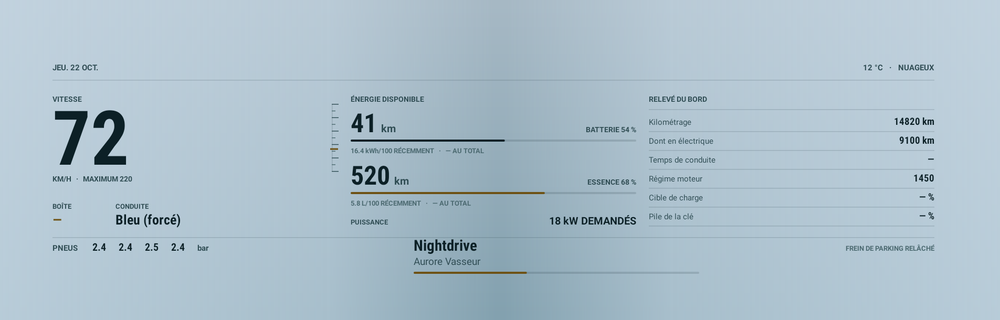

# V E K T R A

**Das Kombiinstrument deines BYD, nach deinem Geschmack.**

Individuelles Kombiinstrument für den Bildschirm hinter dem Lenkrad von BYD-DiLink-3-Fahrzeugen.

**VERSION 1.7.0** · veröffentlicht am 23. Oktober 2026 · 3.1 MB

[**Anwendung herunterladen**](https://giino01.github.io/Vektra/Vektra-1.7.0.apk) · [**Projektseite**](https://giino01.github.io/Vektra/)

[Français](README.md) · [English](README.en.md) · [Italiano](README.it.md) · **Deutsch** · [Português](README.pt.md) · [Türkçe](README.tr.md)

---

## Überblick

Von links nach rechts: das Datum, der **Zeigertacho** mit Skala bis 220 km/h, der **laufende Titel** aus jeder beliebigen App, drei je nach Modus gewählte Werte, die **Energieflusslinie**, deren Mittelpunkt beim Entladen rot nach rechts und beim Laden grün nach links wandert, dann das **animierte Wetter** und der **Druck aller vier Reifen** in bar.

Im Sport-Modus wird die Stimmung rot, ein `SPORT`-Abzeichen erscheint und die drei unteren Werte ändern sich: Leistung, Drehzahl und Gaspedalstellung statt Verbrauch und Batterie.

> Die Bilder auf dieser Seite werden bei jeder Veröffentlichung **vom Code der veröffentlichten Version gezeichnet**, mit Beispielwerten. Sie können also keine ältere Version zeigen als die hier angebotene.

## Acht Themen

Die Taste **Thema** blättert durch acht Anordnungen: Carbon, Carbon 3D, Grand Tourer, Energiefluss, Obsidian, Rot Sport, Lumen und Nebula. Ein Druck wechselt zur nächsten. Die Wahl wird gemerkt und kehrt beim nächsten Start zurück.

Jedes Thema gibt es dunkel und hell. Der helle Hintergrund nimmt das Blaugrau der BYD-Oberfläche auf, auf Fotos ausgemessen, damit die App darin verschmilzt statt darauf zu liegen. Die Einstellung **Erscheinungsbild** wählt das eine, das andere, oder folgt dem Tablet.

## Was nötig ist

- Ein **BYD mit DiLink 3** (Android 10). Entwickelt auf einem Seal U DM-i; andere DiLink-3-Modelle wurden nicht geprüft.
- Das Tablet muss die **Installation fremder Anwendungen** zulassen (Sideload).
- **ADB-Debugging über Netzwerk** auf dem Tablet aktiv, Port 5555. VEKTRA verbindet sich lokal auf dem Tablet selbst — nichts verlässt das Fahrzeug.
- Eine Internetverbindung auf dem Tablet für Wetter und Aktualisierungen. Alles andere läuft offline.

**Warum ADB.** Die Befehle, die den Kombi-Bildschirm freigeben, sind nur dem `shell`-Benutzer von Android erlaubt. Eine gewöhnliche Anwendung kann sie nicht senden. VEKTRA geht deshalb lokal über das ADB des Tablets, um dieses Recht zu erhalten.

## Installation

1. Lade die Anwendungsdatei von dieser Seite auf das Tablet.
2. Öffne sie und bestätige die Installation. Lehnt Android ab, erlaube „unbekannte Quellen" für den verwendeten Dateimanager.
3. Öffne VEKTRA. Beim allerersten Start fragt der Startbildschirm nach der Sprache.
4. Tippe auf **Weiter**. Der Hauptbildschirm öffnet sich.
5. Beim ersten gesendeten Befehl erscheint die Abfrage **„USB-Debugging zulassen?"**. Setze das Häkchen bei **Immer zulassen** und bestätige. Sie erscheint nur einmal.

Sechs Sprachen stehen zur Verfügung: Französisch, Englisch, Italienisch, Deutsch, brasilianisches Portugiesisch und Türkisch.

## Anzeige einschalten

1. Tippe im Bereich **Kontrolle** auf **Prüfen · ADB und Diagnose**. Das löst die Debugging-Abfrage aus und bestätigt, dass die Verbindung steht.
2. Gehe zurück zu **Kombiinstrument** und tippe auf **Auf dem Kombi anzeigen**.
3. Die Serienanzeige geht in den Ruhezustand, der virtuelle Kombi-Bildschirm wird erzeugt, dann erscheint VEKTRA darauf. Das dauert etwa zehn Sekunden.
4. Die Vorschau in der Mitte des Tablets zeigt live, was hinter dem Lenkrad gezeichnet wird. Die Taste **Vorschau** klappt sie zu, wenn du lieber eine Statusübersicht hast.

**Zum Zurückgehen** tippe auf **Original wiederherstellen**: die BYD-Anzeige übernimmt wieder. Kehrt sie nicht zurück, Zündung aus- und wieder einschalten.

## Die vier Bereiche

| Bereich | Wofür er da ist |
| --- | --- |
| **Kombiinstrument** | Die Live-Vorschau, die Anzeigetaste, die Wahl von Bildschirm, Modus und Thema. |
| **Kontrolle** | Der vollständige Bericht der erkannten Geräte, mit einer Taste zum Kopieren. |
| **Protokoll** | Jeder gesendete Befehl und jede empfangene Antwort. |
| **Einstellungen** | Sprache, Erscheinungsbild, Autostart, Musikzugriff, Aktualisierungen, Wetter. |

## Musik

Um den laufenden Titel anzuzeigen, braucht VEKTRA den **Benachrichtigungszugriff**: so verlangt es Android zum Lesen der Audiositzungen. Tippe auf die Zeile **Benachrichtigungszugriff**, und die App erteilt ihn sich selbst über ADB, ohne etwas aus der bestehenden Liste zu löschen. Danach erscheinen Titel, Interpret, Cover und Fortschritt, **egal welche App spielt** — Radio, Bluetooth oder eine installierte App.

## Automatisches Starten und Beenden

Ist diese Einstellung aktiv, übernimmt VEKTRA das Kombi, sobald das Auto eingeschaltet wird, und gibt es frei, sobald es ausgeschaltet wird. Der Fahrzeugzustand wird **direkt im Auto** gelesen, einmal pro Sekunde: 0 aus, 1 Zubehör, 2 Zündung an. Ein Abschalten muss zweimal hintereinander bestätigt werden, bevor der Bildschirm freigegeben wird — ein einzelner Aussetzer darf die Anzeige nicht während der Fahrt verschwinden lassen.

## Erscheinungsbild

Dunkel, hell oder automatisch — das Erscheinungsbild folgt dann dem Tablet. Die Einstellung betrifft nur das Kombi: der Tablet-Bildschirm bleibt immer dunkel, er ist ein Cockpit.

## Aktualisierung

VEKTRA prüft bei jedem Öffnen selbst. Ist eine Version verfügbar, zeigt ein Fenster die Neuerungen und bietet **Später** oder **Herunterladen und installieren**. Bei Zustimmung lädt sich die App herunter, installiert sich darüber und öffnet sich wieder. Alle Versionen tragen die **gleiche Signatur**: eine Aktualisierung ersetzt die vorherige immer, ohne dass Android sie ablehnt, und ohne die Einstellungen zu verlieren.

## Wenn etwas klemmt

- **Das Kombi bleibt eingefroren.** Tippe auf *Original wiederherstellen* und versuche es erneut. Ändert sich nichts, Zündung aus- und wieder einschalten.
- **Keine Daten, nur Striche.** Das Fahrzeug-SDK hat nicht geantwortet. Der Bereich Kontrolle zeigt, welche Geräte erreichbar sind.
- **Die Musik erscheint nicht.** Der Benachrichtigungszugriff wurde nicht erteilt: siehe oben. Prüfe auch, ob wirklich etwas spielt.
- **Die Aktualisierung meldet „Nicht verfügbar".** Das Tablet hat die Quelle nicht erreicht. Prüfe die Internetverbindung und versuche es erneut: der genaue Grund wird angezeigt.
- **Etwas anderes.** Öffne *Kontrolle*, tippe auf *Ganzen Scan kopieren* und sende den Text. Er enthält alles Nötige zum Verstehen.

## Neu in 1.7.0

- maj
- maj

---

Privates Projekt, ohne jede Verbindung zu BYD. Installation und Nutzung auf eigene Gefahr. Die angezeigten Angaben stammen aus dem Fahrzeugsystem und können falsch sein: verlasse dich beim Fahren nie darauf.
