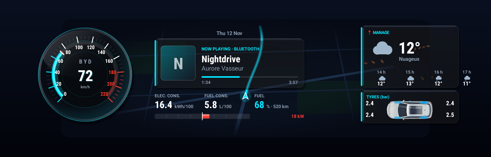
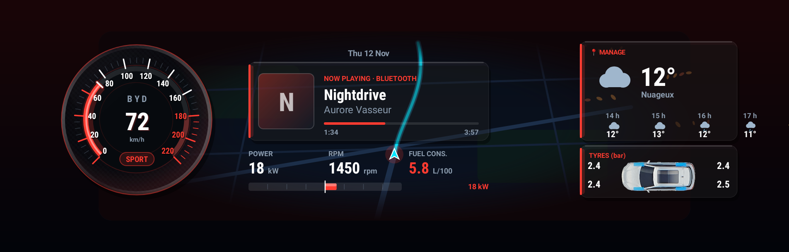
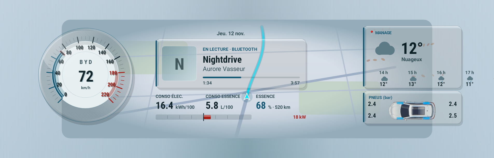
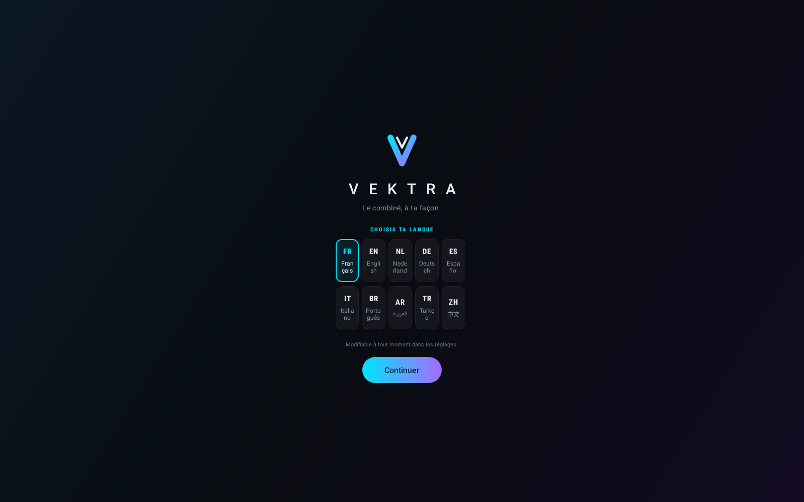
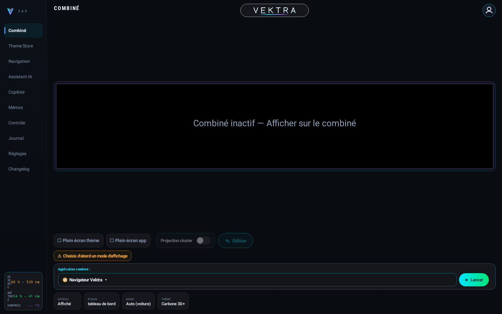
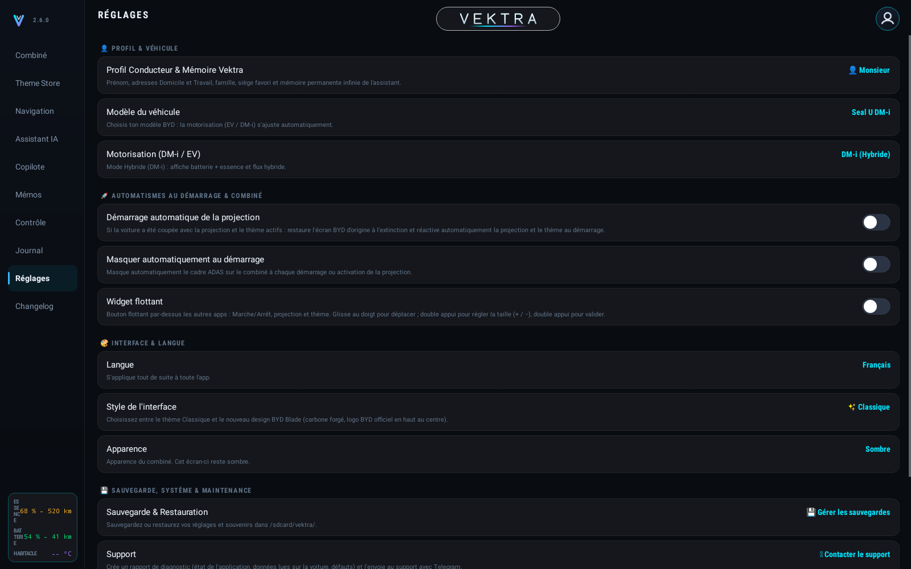

# V E K T R A

**Le combiné de ta BYD, à ta façon.**

Tableau de bord personnalisé pour l'écran derrière le volant des véhicules BYD DiLink 3.

**VERSION 2.6.0** · publiée le 12 novembre 2026 · 75.6 Mo

[**Télécharger l'application**](https://giino01.github.io/Vektra/Vektra-2.6.0.apk) · [**Page du projet**](https://giino01.github.io/Vektra/)

**Français** · [English](README.en.md) · [Italiano](README.it.md) · [Deutsch](README.de.md) · [Português](README.pt.md) · [Türkçe](README.tr.md)

---

## Aperçu

De gauche à droite : la date, le **compteur à aiguille** gradué jusqu'à 220 km/h, la **musique en cours** quelle que soit l'application qui la joue, trois chiffres choisis selon le mode, la **ligne de flux d'énergie** dont le point central part vers la droite en rouge quand la batterie se décharge et vers la gauche en vert quand elle se recharge, puis la **météo animée** et la **pression des quatre pneus** en bar.

En Sport, l'ambiance passe au rouge, une pastille `SPORT` apparaît et les trois chiffres du bas changent : puissance, régime moteur et position de l'accélérateur, à la place des consommations et de la batterie.

> Les captures de cette page sont **dessinées par le code de la version publiée** à chaque publication, avec des valeurs de démonstration. Elles ne peuvent donc pas montrer une version plus ancienne que celle proposée ici.

## Les thèmes

La touche **Thème** ouvre le **Theme Store** et fait défiler les thèmes installés. **Carbone 3D** est le thème intégré par défaut et **VektraUI** l'autre thème intégré ; le thème **Aston** se télécharge en un geste. Le choix est retenu et revient à l'allumage.

Chaque thème existe en sombre et en clair. Le fond clair reprend le bleu-gris de la surcouche BYD, mesuré sur photo, pour que l'application se fonde dedans au lieu d'y être posée. Le réglage **Apparence** choisit l'un, l'autre, ou suit la tablette.

## Ce qu'il faut

- Un véhicule **BYD équipé de DiLink 3.0 (13.1.32 et 13.1.33), DiLink 4.0 ou DiLink 5.0 / 5.1**, reconnu automatiquement.
- La tablette doit accepter l'**installation d'applications extérieures** (sideload).
- Le **débogage ADB en réseau** actif sur la tablette, port 5555. VEKTRA s'y connecte en local, sur la tablette elle-même — rien ne sort du véhicule.
- Une connexion internet sur la tablette pour la météo et les mises à jour. Tout le reste fonctionne hors ligne.

**Pourquoi l'ADB.** Les commandes qui libèrent l'écran du combiné ne sont autorisées qu'à l'utilisateur `shell` d'Android. Une application ordinaire ne peut pas les envoyer. VEKTRA passe donc par l'ADB de la tablette, en local, pour obtenir ce droit.

## Installation

1. Télécharge le fichier de l'application depuis cette page, sur la tablette.
2. Ouvre-le et accepte l'installation. Si Android refuse, autorise les « sources inconnues » pour le gestionnaire de fichiers utilisé.
3. Ouvre VEKTRA. Au tout premier démarrage, l'écran d'accueil demande la langue, puis le modèle de ta voiture.
4. Choisis ta langue puis ton modèle, en appuyant sur **Continuer** à chaque étape. L'écran principal s'ouvre.
5. La première commande envoyée fera apparaître la demande **« Autoriser le débogage USB ? »**. Coche **Toujours autoriser**, puis accepte. Cette demande n'apparaît qu'une fois.

Dix langues sont disponibles : français, anglais, néerlandais, allemand, espagnol, italien, portugais du Brésil, arabe, turc et chinois.

## Activer l'affichage

1. Dans la section **Contrôle**, appuie sur **Vérifier · ADB et diagnostic**. C'est ce qui déclenche l'autorisation de débogage et confirme que la connexion fonctionne.
2. Reviens sur **Combiné** et appuie sur **Afficher sur le combiné**. Avant cela, coche un mode d'affichage : **Plein écran thème** ou **Plein écran app** (et **Petit écran** sur Sealion 7). Sans mode coché, la projection ne démarre pas, même au démarrage de la voiture.
3. Le tableau de bord d'origine se met en veille, l'écran virtuel du combiné est créé, puis VEKTRA s'y affiche. L'opération prend une dizaine de secondes.
4. L'aperçu au centre de la tablette montre en direct ce qui est dessiné derrière le volant. Le bouton **Aperçu** le replie si tu préfères un tableau d'état.

**Pour revenir en arrière**, appuie sur **Revenir à l'origine** : le tableau de bord BYD reprend la main. Si jamais il ne revient pas, coupe puis remets le contact.

## Le rail de gauche

| Section | À quoi elle sert |
| --- | --- |
| **Combiné** | L'aperçu en direct, le bouton d'affichage, le choix de l'écran, du mode et du thème. |
| **Contrôle** | Le relevé complet des équipements détectés, avec un bouton pour tout copier. |
| **Journal** | Chaque commande envoyée et chaque réponse reçue. |
| **Réglages** | Langue, apparence, démarrage automatique, accès musique, mises à jour, météo. |

## Musique

Pour afficher le morceau en cours, VEKTRA a besoin de l'**accès aux notifications** : c'est la règle d'Android pour lire les sessions audio. Appuie sur la ligne **Accès aux notifications** et l'application se l'accorde elle-même par l'ADB, sans rien effacer de la liste existante. Une fois accordé, le titre, l'artiste, la pochette et la progression s'affichent, **quelle que soit l'application qui joue** — radio, Bluetooth, ou une app installée.

## Démarrage et arrêt automatiques

Quand ce réglage est actif, VEKTRA prend le combiné dès que la voiture est allumée et le rend dès qu'elle est coupée. L'état du véhicule est lu **directement dans la voiture**, une fois par seconde : 0 éteint, 1 accessoires, 2 contact mis. Une coupure doit être confirmée deux fois d'affilée avant que l'écran soit rendu — un seul hoquet de la voiture ne doit pas faire disparaître l'affichage en pleine route.

## Apparence

Sombre, claire, ou automatique — l'apparence suit alors celle de la tablette. Le réglage ne concerne que le combiné : l'écran de la tablette reste sombre en toutes circonstances, c'est un poste de pilotage.

## Mise à jour

VEKTRA vérifie toute seule à chaque ouverture. Quand une version est disponible, une fenêtre affiche les nouveautés et propose **Plus tard** ou **Télécharger et installer**. Si tu acceptes, l'application se télécharge, s'installe par-dessus et se rouvre seule. Toutes les versions portent la **même signature** : une mise à jour remplace toujours la précédente sans qu'Android la refuse, et sans perdre les réglages.

## En cas de souci

- **Le combiné reste figé.** Appuie sur *Revenir à l'origine*, puis réessaie. Si rien ne change, coupe et remets le contact.
- **Aucune donnée, que des tirets.** Le SDK de la voiture n'a pas répondu. La section Contrôle dit lesquels des appareils sont joignables.
- **La musique ne s'affiche pas.** L'accès aux notifications n'est pas accordé : voir plus haut. Vérifie aussi que quelque chose joue réellement.
- **La mise à jour dit « Indisponible ».** La tablette n'a pas joint la source. Vérifie sa connexion internet, puis réessaie : la raison exacte s'affiche.
- **Autre chose.** Ouvre *Contrôle*, appuie sur *Copier tout le scan*, puis envoie le texte. Il contient tout ce qu'il faut pour comprendre.

## Nouveautés de la 2.6.0

- À savoir : après la mise à jour, aucun mode d'affichage n'est coché. Va dans l'onglet Combiné et coche le tien avant de lancer la projection.
- À savoir : au premier appel « Vektra », l'application télécharge une seule fois environ 40 Mo pour reconnaître ta langue.
- Ajout : 11 nouveaux thèmes dans le Theme Store : Châssis, Orbit, Sport, Carte, Horizon, Aurore, Chronographe, Énergie, Ciel, Carbone 3D+ et VektraUI+.
- Ajout : Carbone 3D+, des cadrans 3D sous verre, et VektraUI+, des arches néon.
- Ajout : thèmes animés : la route d'Horizon défile avec ta vitesse, Aurore et Énergie bougent, Ciel montre la météo réelle.
- Ajout : Carte, Carbone 3D+ et VektraUI+ affichent ton application (Waze, Google Maps…) ou la Navigation Vektra au centre du combiné.
- Ajout : Édition : déplace, agrandis ou masque chaque bloc d'un thème, puis enregistre.
- Ajout : le fond des thèmes se raccorde au combiné, en clair comme en sombre.
- Ajout : mode Plein écran app : seule ton application est affichée sur le combiné, à déplacer et redimensionner dans Édition.
- Ajout : Aperçu interaction : règle la taille de l'application et de son texte, et la taille de la carte Vektra. Seul le combiné change, jamais la tablette.
- Ajout : nouvelles commandes de la voiture, aussi à la voix : vitres (même en %), toit ouvrant, store, coffre, verrouillage, mémoire de siège 1/2/3, clim par zone, ventilation, sièges et volant chauffants, feux, éclairage d'ambiance, chargeur sans fil, mode de conduite, régénération, rétroviseurs, feux de détresse, limite de charge et recharge programmée.
- Ajout : Copilote : alerte quand la batterie 12 V est faible.
- Ajout : thèmes Classique et Blade : ESSENCE (hybrides DM-i), BATTERIE et HABITACLE en bas à gauche.
- Ajout : rien de ce que tu dis n'est envoyé sur internet avant le mot « Vektra ».
- Ajout (SEALION7) : deux profils d'affichage : Plein écran (VEKTRA sous la bande du haut de la voiture) ou Petit écran (ton application dans la fenêtre de droite).
- Ajout (SEALION7) : une version Sealion 7 de chaque thème.
- Ajout (SEALION7) : données de la voiture : vitesse, P/R/N/D, batterie, autonomie, kilométrage, batterie 12 V, recharge, pneus et puissance.
- Ajout (SEALION7) : affichage forcé : VEKTRA passe devant la navigation d'origine du combiné.
- Correctif (SEALION7) : vitesse et aiguille fluides, sans décalage.
- Correctif (SEALION7) : le rapport P/R/N/D est juste, et l'ouverture des portes et du coffre en D est de nouveau bloquée.
- Correctif (SEALION7) : la température extérieure ne reste plus bloquée à 0 °C.
- Correctif : Vektra répond tout de suite, même quand la musique joue.
- Correctif : mémoire de siège : le siège va jusqu'à sa position sans s'arrêter en route.
- Correctif : HABITACLE affiche la vraie température de l'habitacle, et non la consigne de la clim.
- Correctif : application projetée : toutes ses fenêtres vont sur le combiné, et Fermer l'arrête complètement.
- Correctif : projection des applications plus fluide.
- Correctif : plus de voix robotique au démarrage.
- Correctif : la météo s'affiche vite au démarrage, sans ville par défaut.

---

Projet personnel, sans aucun lien avec BYD. Installation et usage à tes risques. Les informations affichées viennent du système de la voiture et peuvent être inexactes : ne t'y fie jamais pour conduire.
