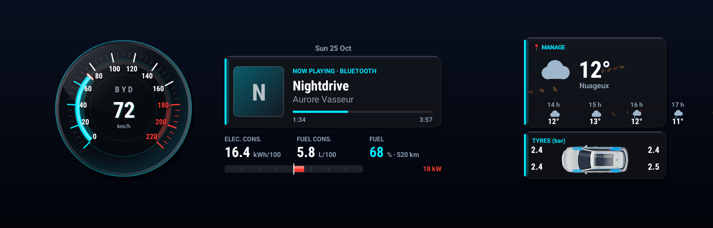
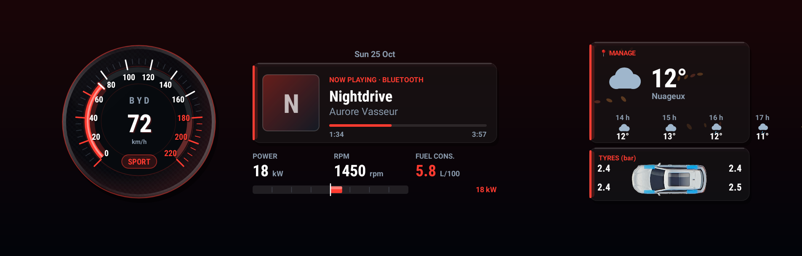
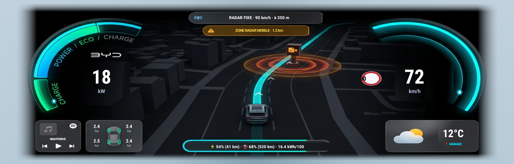
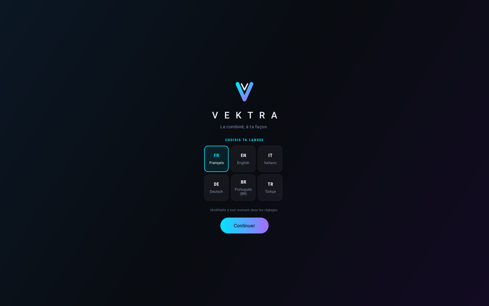
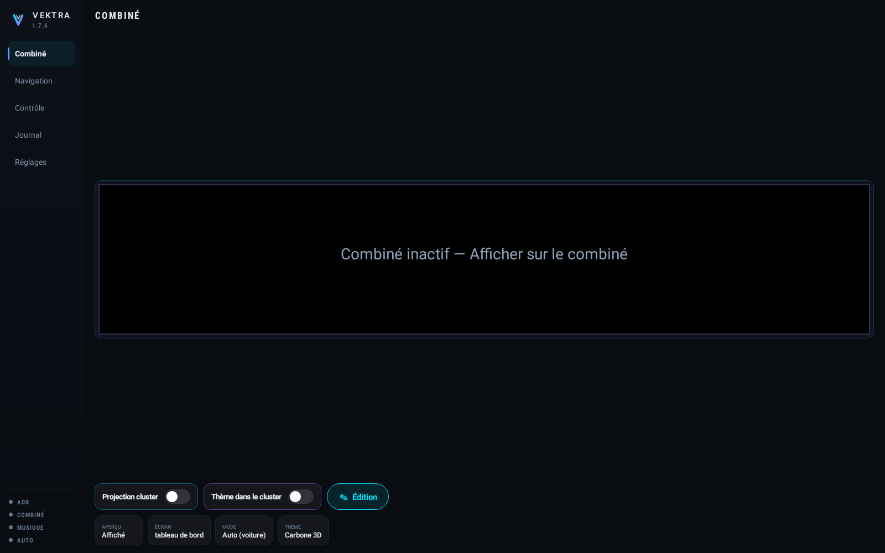
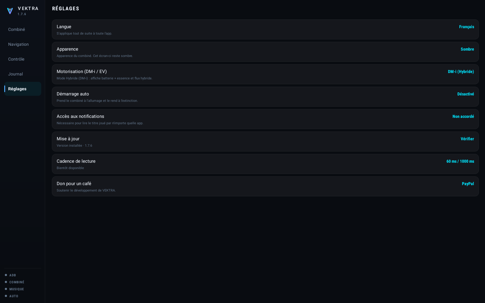

# V E K T R A

**O painel da sua BYD, do seu jeito.**

Painel personalizado para o ecrã atrás do volante dos veículos BYD DiLink 3.

**VERSÃO 1.7.6** · publicada a 25 de outubro de 2026 · 40.9 MB

[**Transferir a aplicação**](https://giino01.github.io/Vektra/Vektra-1.7.6.apk) · [**Página do projeto**](https://giino01.github.io/Vektra/)

[Français](README.md) · [English](README.en.md) · [Italiano](README.it.md) · [Deutsch](README.de.md) · **Português** · [Türkçe](README.tr.md)

---

## Visão geral

Da esquerda para a direita: a data, o **velocímetro de ponteiro** graduado até 220 km/h, a **música a tocar** seja qual for a aplicação, três valores escolhidos conforme o modo, a **linha de fluxo de energia** cujo ponto central vai para a direita a vermelho quando a bateria descarrega e para a esquerda a verde quando carrega, depois a **meteorologia animada** e a **pressão dos quatro pneus** em bar.

Em Sport o ambiente fica vermelho, aparece um emblema `SPORT` e os três valores de baixo mudam: potência, rotação do motor e posição do acelerador, em vez dos consumos e da bateria.

> As imagens desta página são **desenhadas pelo código da versão publicada** em cada publicação, com valores de demonstração. Não podem mostrar uma versão mais antiga do que a oferecida aqui.

## Oito temas

A tecla **Tema** percorre oito disposições do painel: Carbono, Carbono 3D, Grande Turismo, Fluxo de energia, Obsidiana, Vermelho Sport, Lumen e Nebulosa. Um toque passa à seguinte. A escolha fica guardada e volta no arranque.

Cada tema existe em escuro e em claro. O fundo claro retoma o azul-acinzentado da interface BYD, medido em fotografia, para que a aplicação se funda nela em vez de ficar por cima. A definição **Aparência** escolhe um, o outro, ou segue o tablet.

## O que é preciso

- Um **BYD com DiLink 3** (Android 10). Desenvolvido num Seal U DM-i; outros modelos DiLink 3 não foram verificados.
- O tablet tem de aceitar a **instalação de aplicações externas** (sideload).
- A **depuração ADB em rede** ativa no tablet, porta 5555. O VEKTRA liga-se localmente, no próprio tablet — nada sai do veículo.
- Uma ligação à internet no tablet para a meteorologia e as atualizações. Tudo o resto funciona offline.

**Porquê o ADB.** Os comandos que libertam o ecrã do painel só são permitidos ao utilizador `shell` do Android. Uma aplicação normal não os pode enviar. O VEKTRA passa por isso pelo ADB do tablet, localmente, para obter esse direito.

## Instalação

1. Transfere o ficheiro da aplicação a partir desta página, no tablet.
2. Abre-o e aceita a instalação. Se o Android recusar, autoriza as «fontes desconhecidas» para o gestor de ficheiros usado.
3. Abre o VEKTRA. No primeiro arranque, o ecrã inicial pergunta o idioma.
4. Carrega em **Continuar**. Abre-se o ecrã principal.
5. O primeiro comando enviado fará aparecer o pedido **«Permitir depuração USB?»**. Assinala **Permitir sempre** e aceita. Só aparece uma vez.

Estão disponíveis seis idiomas: francês, inglês, italiano, alemão, português do Brasil e turco.

## Ativar a visualização

1. Na secção **Controlo**, carrega em **Verificar · ADB e diagnóstico**. É o que despoleta a autorização de depuração e confirma que a ligação funciona.
2. Volta a **Painel** e carrega em **Mostrar no painel**.
3. O painel original entra em suspensão, o ecrã virtual do painel é criado e o VEKTRA aparece nele. A operação demora uns dez segundos.
4. A pré-visualização no centro do tablet mostra em direto o que é desenhado atrás do volante. O botão **Pré-visualização** fecha-a se preferires um quadro de estado.

**Para voltar atrás**, carrega em **Repor o original**: o painel BYD retoma o comando. Se não voltar, desliga e volta a ligar a ignição.

## As quatro secções

| Secção | Para que serve |
| --- | --- |
| **Painel** | A pré-visualização em direto, o botão de visualização, a escolha do ecrã, do modo e do tema. |
| **Controlo** | O relatório completo dos equipamentos detetados, com um botão para copiar tudo. |
| **Registo** | Cada comando enviado e cada resposta recebida. |
| **Definições** | Idioma, aparência, arranque automático, acesso à música, atualizações, meteorologia. |

## Música

Para mostrar a música a tocar, o VEKTRA precisa do **acesso às notificações**: é a regra do Android para ler as sessões áudio. Carrega na linha **Acesso às notificações** e a aplicação concede-o a si própria através do ADB, sem apagar nada da lista existente. Depois disso, o título, o artista, a capa e o progresso aparecem, **seja qual for a aplicação a tocar** — rádio, Bluetooth ou uma app instalada.

## Arranque e paragem automáticos

Com esta definição ativa, o VEKTRA assume o painel assim que o carro é ligado e devolve-o assim que é desligado. O estado do veículo é lido **diretamente no carro**, uma vez por segundo: 0 desligado, 1 acessórios, 2 ignição ligada. Um corte tem de ser confirmado duas vezes seguidas antes de o ecrã ser devolvido — um único soluço não deve fazer desaparecer a visualização em andamento.

## Aparência

Escuro, claro ou automático — a aparência segue então a do tablet. A definição diz respeito apenas ao painel: o ecrã do tablet permanece escuro em todas as circunstâncias, é um posto de pilotagem.

## Atualização

O VEKTRA verifica sozinho a cada abertura. Quando há uma versão disponível, uma janela mostra as novidades e propõe **Mais tarde** ou **Transferir e instalar**. Se aceitares, a aplicação transfere-se, instala-se por cima e reabre sozinha. Todas as versões têm a **mesma assinatura**: uma atualização substitui sempre a anterior sem que o Android a recuse, e sem perder as definições.

## Em caso de problema

- **O painel fica congelado.** Carrega em *Repor o original* e tenta de novo. Se nada mudar, desliga e volta a ligar a ignição.
- **Sem dados, só traços.** O SDK do carro não respondeu. A secção Controlo diz quais os dispositivos acessíveis.
- **A música não aparece.** O acesso às notificações não foi concedido: ver acima. Verifica também se algo está mesmo a tocar.
- **A atualização diz «Indisponível».** O tablet não alcançou a fonte. Verifica a ligação à internet e tenta de novo: o motivo exato é mostrado.
- **Outra coisa.** Abre *Controlo*, carrega em *Copiar todo o scan* e envia o texto. Contém tudo o que é preciso para perceber.

## Novidades da 1.7.6

- Integração nativa do motor MapLibre OpenGL ES 3.0 (libmaplibre.so C++) diretamente no APK, otimizado para a GPU Qualcomm Adreno 600: renderização por hardware a 60 FPS, setSwapBehaviorFlush(true) para tela dupla, pré-carregamento de blocos e extrusão 3D de edifícios (fill-extrusion).
- Navegação MapLibre OpenGL visível diretamente no painel de instrumentos como um APK nativo: integrada no centro dos 4 temas 3D e disponível em Tela Cheia no Painel (Screen.NAVIGATION).

---

Projeto pessoal, sem qualquer ligação à BYD. Instalação e utilização por tua conta e risco. As informações mostradas vêm do sistema do carro e podem estar incorretas: nunca confies nelas para conduzir.
