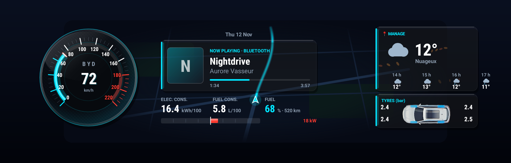
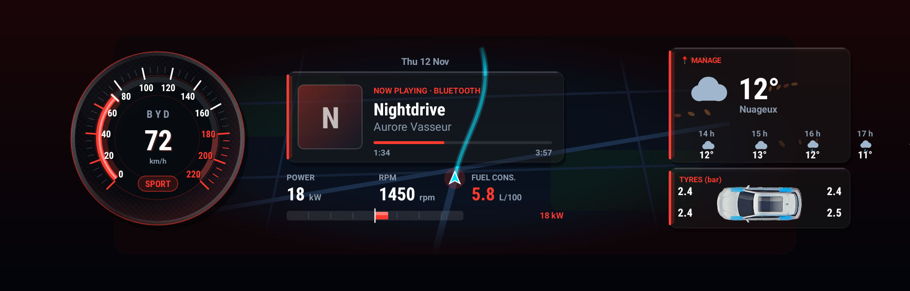
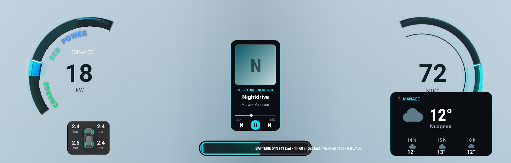
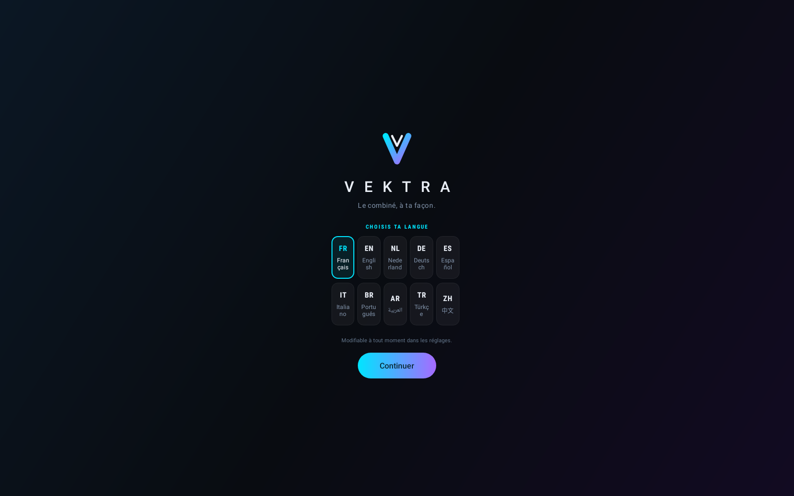
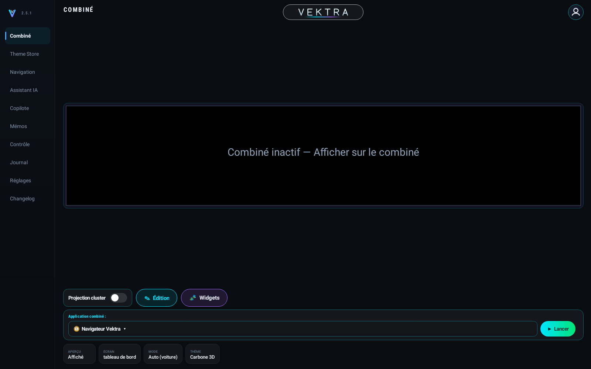
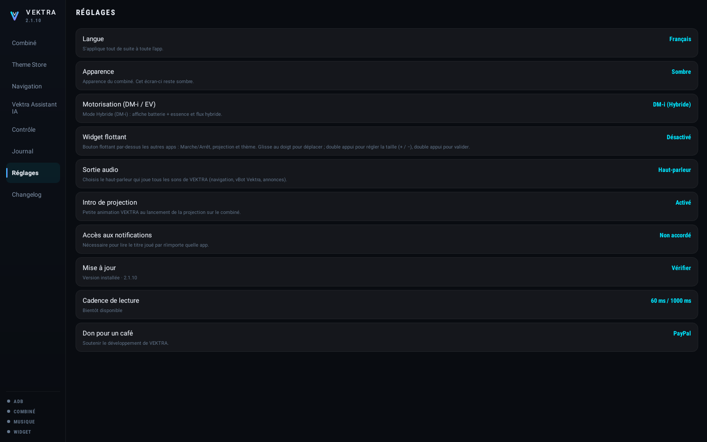

# V E K T R A

**O painel da sua BYD, do seu jeito.**

Painel personalizado para o ecrã atrás do volante dos veículos BYD DiLink 3.

**VERSÃO 2.6.0** · publicada a 12 de novembro de 2026 · 75.6 MB

[**Transferir a aplicação**](https://giino01.github.io/Vektra/Vektra-2.6.0.apk) · [**Página do projeto**](https://giino01.github.io/Vektra/)

[Français](README.md) · [English](README.en.md) · [Italiano](README.it.md) · [Deutsch](README.de.md) · **Português** · [Türkçe](README.tr.md)

---

## Visão geral

Da esquerda para a direita: a data, o **velocímetro de ponteiro** graduado até 220 km/h, a **música a tocar** seja qual for a aplicação, três valores escolhidos conforme o modo, a **linha de fluxo de energia** cujo ponto central vai para a direita a vermelho quando a bateria descarrega e para a esquerda a verde quando carrega, depois a **meteorologia animada** e a **pressão dos quatro pneus** em bar.

Em Sport o ambiente fica vermelho, aparece um emblema `SPORT` e os três valores de baixo mudam: potência, rotação do motor e posição do acelerador, em vez dos consumos e da bateria.

> As imagens desta página são **desenhadas pelo código da versão publicada** em cada publicação, com valores de demonstração. Não podem mostrar uma versão mais antiga do que a oferecida aqui.

## Os temas

A tecla **Tema** abre a **Theme Store** e percorre os temas instalados. **Carbone 3D** é o tema integrado predefinido e **VektraUI** o outro tema integrado; o tema **Aston** descarrega-se com um toque. A escolha fica guardada e volta no arranque.

Cada tema existe em escuro e em claro. O fundo claro retoma o azul-acinzentado da interface BYD, medido em fotografia, para que a aplicação se funda nela em vez de ficar por cima. A definição **Aparência** escolhe um, o outro, ou segue o tablet.

## O que é preciso

- Um **BYD com DiLink 3.0 (13.1.32 e 13.1.33), DiLink 4.0 ou DiLink 5.0 / 5.1**, detetado automaticamente.
- O tablet tem de aceitar a **instalação de aplicações externas** (sideload).
- A **depuração ADB em rede** ativa no tablet, porta 5555. O VEKTRA liga-se localmente, no próprio tablet — nada sai do veículo.
- Uma ligação à internet no tablet para a meteorologia e as atualizações. Tudo o resto funciona offline.

**Porquê o ADB.** Os comandos que libertam o ecrã do painel só são permitidos ao utilizador `shell` do Android. Uma aplicação normal não os pode enviar. O VEKTRA passa por isso pelo ADB do tablet, localmente, para obter esse direito.

## Instalação

1. Transfere o ficheiro da aplicação a partir desta página, no tablet.
2. Abre-o e aceita a instalação. Se o Android recusar, autoriza as «fontes desconhecidas» para o gestor de ficheiros usado.
3. Abre o VEKTRA. No primeiro arranque, o ecrã inicial pergunta o idioma e depois o modelo do teu carro.
4. Escolhe o idioma e depois o modelo, carregando em **Continuar** em cada passo. Abre-se o ecrã principal.
5. O primeiro comando enviado fará aparecer o pedido **«Permitir depuração USB?»**. Assinala **Permitir sempre** e aceita. Só aparece uma vez.

Estão disponíveis dez idiomas: francês, inglês, neerlandês, alemão, espanhol, italiano, português do Brasil, árabe, turco e chinês.

## Ativar a visualização

1. Na secção **Controlo**, carrega em **Verificar · ADB e diagnóstico**. É o que despoleta a autorização de depuração e confirma que a ligação funciona.
2. Volta a **Painel** e carrega em **Mostrar no painel**. Antes, marca um modo de visualização: **Tema em ecrã inteiro** ou **Aplicação em ecrã inteiro** (e **Ecrã pequeno** no Sealion 7). Sem modo marcado, a projeção não arranca, nem ao ligar o carro.
3. O painel original entra em suspensão, o ecrã virtual do painel é criado e o VEKTRA aparece nele. A operação demora uns dez segundos.
4. A pré-visualização no centro do tablet mostra em direto o que é desenhado atrás do volante. O botão **Pré-visualização** fecha-a se preferires um quadro de estado.

**Para voltar atrás**, carrega em **Repor o original**: o painel BYD retoma o comando. Se não voltar, desliga e volta a ligar a ignição.

## A barra à esquerda

| Secção | Para que serve |
| --- | --- |
| **Painel** | A pré-visualização em direto, o botão de visualização, a escolha do ecrã, do modo e do tema. |
| **Controlo** | O relatório completo dos equipamentos detetados, com um botão para copiar tudo. |
| **Registo** | Cada comando enviado e cada resposta recebida. |
| **Definições** | Idioma, aparência, arranque automático, acesso à música, atualizações, meteorologia. |

## Música

Para mostrar a música a tocar, o VEKTRA precisa do **acesso às notificações**: é a regra do Android para ler as sessões áudio. Carrega na linha **Acesso às notificações** e a aplicação concede-o a si própria através do ADB, sem apagar nada da lista existente. Depois disso, o título, o artista, a capa e o progresso aparecem, **seja qual for a aplicação a tocar** — rádio, Bluetooth ou uma app instalada.

## Arranque e paragem automáticos

Com esta definição ativa, o VEKTRA assume o painel assim que o carro é ligado e devolve-o assim que é desligado. O estado do veículo é lido **diretamente no carro**, uma vez por segundo: 0 desligado, 1 acessórios, 2 ignição ligada. Um corte tem de ser confirmado duas vezes seguidas antes de o ecrã ser devolvido — um único soluço não deve fazer desaparecer a visualização em andamento.

## Aparência

Escuro, claro ou automático — a aparência segue então a do tablet. A definição diz respeito apenas ao painel: o ecrã do tablet permanece escuro em todas as circunstâncias, é um posto de pilotagem.

## Atualização

O VEKTRA verifica sozinho a cada abertura. Quando há uma versão disponível, uma janela mostra as novidades e propõe **Mais tarde** ou **Transferir e instalar**. Se aceitares, a aplicação transfere-se, instala-se por cima e reabre sozinha. Todas as versões têm a **mesma assinatura**: uma atualização substitui sempre a anterior sem que o Android a recuse, e sem perder as definições.

## Em caso de problema

- **O painel fica congelado.** Carrega em *Repor o original* e tenta de novo. Se nada mudar, desliga e volta a ligar a ignição.
- **Sem dados, só traços.** O SDK do carro não respondeu. A secção Controlo diz quais os dispositivos acessíveis.
- **A música não aparece.** O acesso às notificações não foi concedido: ver acima. Verifica também se algo está mesmo a tocar.
- **A atualização diz «Indisponível».** O tablet não alcançou a fonte. Verifica a ligação à internet e tenta de novo: o motivo exato é mostrado.
- **Outra coisa.** Abre *Controlo*, carrega em *Copiar todo o scan* e envia o texto. Contém tudo o que é preciso para perceber.

## Novidades da 2.6.0

- A saber: depois da atualização, nenhum modo de ecrã fica selecionado. Vai ao separador Painel e seleciona o teu antes de iniciar a projeção.
- A saber: na primeira vez que chamas «Vektra», a app transfere uma única vez cerca de 40 MB para reconhecer o teu idioma.
- Novidade: 11 novos temas na Theme Store: Chassi, Orbit, Sport, Mapa, Horizonte, Aurora, Cronógrafo, Energia, Céu, Carbone 3D+ e VektraUI+.
- Novidade: Carbone 3D+, mostradores 3D sob vidro, e VektraUI+, arcos de néon.
- Novidade: temas animados: a estrada do Horizonte passa com a tua velocidade, Aurora e Energia mexem-se, Céu mostra o tempo real.
- Novidade: Mapa, Carbone 3D+ e VektraUI+ mostram a tua app (Waze, Google Maps…) ou a Navigation Vektra no centro do painel.
- Novidade: Edição: move, aumenta ou esconde cada bloco de um tema e depois guarda.
- Novidade: o fundo dos temas liga-se ao painel, em claro e em escuro.
- Novidade: modo Aplicação em ecrã inteiro: só a tua app é mostrada no painel, para mover e redimensionar em Edição.
- Novidade: Prévia › Interaction App: ajusta o tamanho da app e do seu texto, e o tamanho do mapa Vektra. Só o painel muda, nunca o tablet.
- Novidade: novos comandos do carro, também por voz: vidros (até em %), tejadilho, cortina, mala, trancas, memória do banco 1/2/3, climatização por zona, ventilação, bancos e volante aquecidos, luzes, iluminação ambiente, carregador sem fios, modo de condução, regeneração, espelhos, luzes de emergência, limite de carga e carregamento programado.
- Novidade: Copiloto: alerta quando a bateria de 12 V está fraca.
- Novidade: temas Clássico e Blade: COMBUSTÍVEL (híbridos DM-i), BATERIA e HABITÁCULO em baixo à esquerda.
- Novidade: nada do que dizes é enviado para a internet antes da palavra «Vektra».
- Novidade (SEALION7): dois perfis de ecrã: Ecrã inteiro (VEKTRA por baixo da faixa superior do carro) ou Ecrã pequeno (a tua app na janela da direita).
- Novidade (SEALION7): uma versão Sealion 7 de cada tema.
- Novidade (SEALION7): dados do carro: velocidade, P/R/N/D, bateria, autonomia, quilometragem, bateria de 12 V, carregamento, pneus e potência.
- Novidade (SEALION7): exibição forçada: o VEKTRA fica à frente da navegação original do painel.
- Correção (SEALION7): velocidade e ponteiro fluidos, sem atraso.
- Correção (SEALION7): a mudança P/R/N/D está correta, e a abertura das portas e da mala em D volta a estar bloqueada.
- Correção (SEALION7): a temperatura exterior já não fica presa nos 0 °C.
- Correção: a Vektra responde logo, mesmo com música a tocar.
- Correção: memória do banco: o banco vai até à sua posição sem parar a meio.
- Correção: HABITÁCULO mostra a verdadeira temperatura do habitáculo, e não a definida na climatização.
- Correção: app projetada: todas as suas janelas vão para o painel, e Fechar termina-a por completo.
- Correção: projeção das apps mais fluida.
- Correção: acabou a voz robótica no arranque.
- Correção: o tempo aparece depressa no arranque, sem cidade predefinida.

---

Projeto pessoal, sem qualquer ligação à BYD. Instalação e utilização por tua conta e risco. As informações mostradas vêm do sistema do carro e podem estar incorretas: nunca confies nelas para conduzir.
