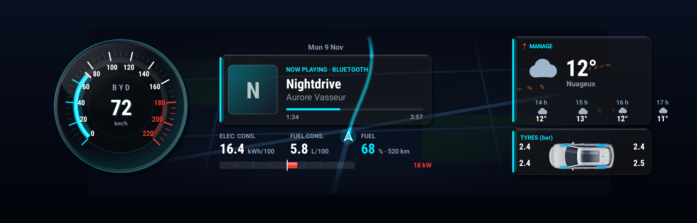
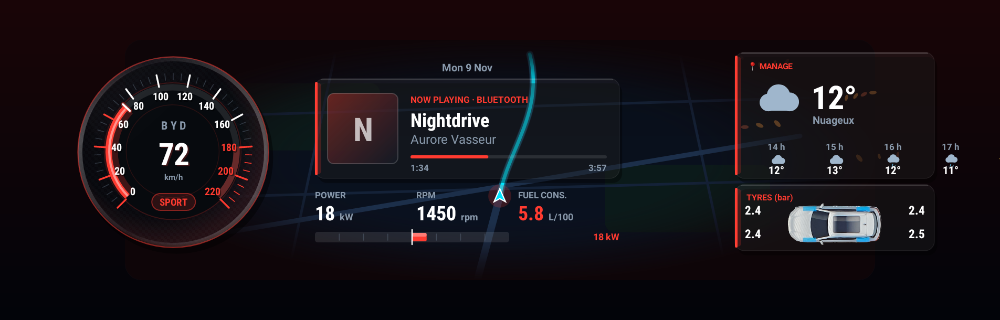
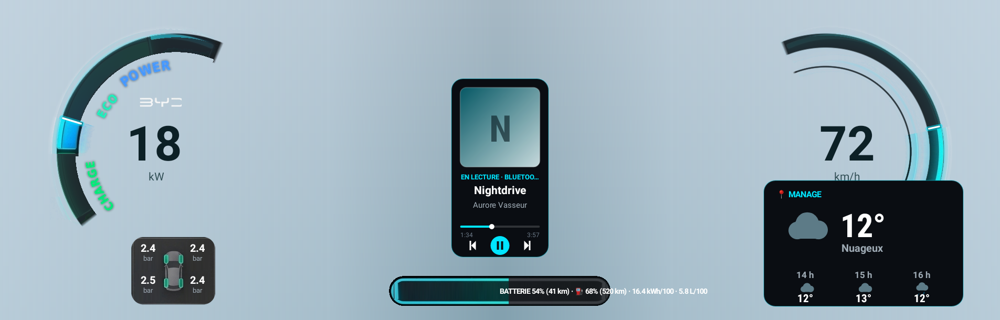
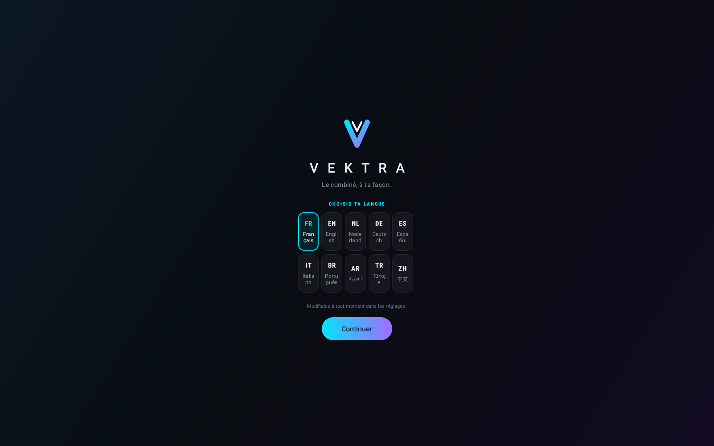
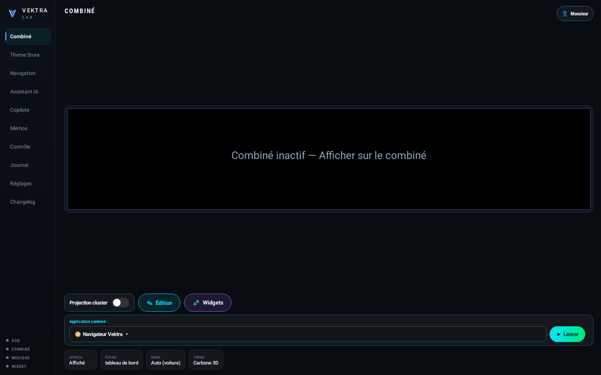
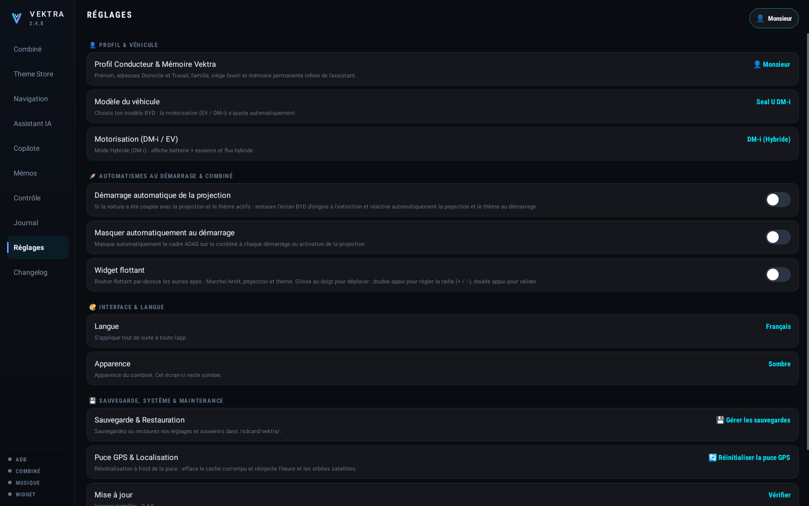

# V E K T R A

**BYD gösterge paneliniz, sizin tarzınızda.**

BYD DiLink 3 araçlarda direksiyon arkasındaki ekran için özel gösterge paneli.

**SÜRÜM 2.4.8** · yayın tarihi 9 Kasım 2026 · 47.0 MB

[**Uygulamayı indir**](https://giino01.github.io/Vektra/Vektra-2.4.8.apk) · [**Proje sayfası**](https://giino01.github.io/Vektra/)

[Français](README.md) · [English](README.en.md) · [Italiano](README.it.md) · [Deutsch](README.de.md) · [Português](README.pt.md) · **Türkçe**

---

## Genel bakış

Soldan sağa: tarih, 220 km/s'e kadar bölümlenmiş **ibreli hız göstergesi**, hangi uygulama çalarsa çalsın **çalan parça**, moda göre seçilen üç değer, batarya boşalırken kırmızı sağa, dolarken yeşil sola giden **enerji akış çizgisi**, ardından **hareketli hava durumu** ve dört **lastiğin basıncı** (bar).

Sport modunda ortam kırmızıya döner, bir `SPORT` rozeti belirir ve alttaki üç değer değişir: tüketim ve batarya yerine güç, motor devri ve gaz pedalı konumu.

> Bu sayfadaki görüntüler her yayında **yayınlanan sürümün kodu tarafından çizilir**, örnek değerlerle. Dolayısıyla burada sunulandan eski bir sürümü gösteremezler.

## Temalar

**Tema** tuşu **Theme Store**'u açar ve yüklü temalar arasında geçiş yapar. **Carbone 3D** yerleşik varsayılan, **VektraUI** diğer yerleşik temadır; **Aston** teması tek dokunuşla indirilir. Seçim hatırlanır ve açılışta geri gelir.

Her tema koyu ve açık olarak vardır. Açık arka plan, fotoğraf üzerinden ölçülen BYD arayüzünün mavi-grisini alır; böylece uygulama üstüne oturmak yerine içine karışır. **Görünüm** ayarı birini, diğerini seçer ya da tableti izler.

## Gerekenler

- Otomatik olarak algılanan **DiLink 3.0 (13.1.32 ve 13.1.33), DiLink 4.0 veya DiLink 5.0 / 5.1 donanımlı bir BYD**.
- Tablet, **dışarıdan uygulama kurulumunu** kabul etmelidir (sideload).
- Tablette **ağ üzerinden ADB hata ayıklama** etkin, 5555 numaralı bağlantı noktası. VEKTRA buna tabletin kendi üzerinden yerel olarak bağlanır — araçtan hiçbir şey dışarı çıkmaz.
- Hava durumu ve güncellemeler için tablette internet bağlantısı. Geri kalan her şey çevrimdışı çalışır.

**Neden ADB.** Gösterge ekranını serbest bırakan komutlara yalnızca Android'in `shell` kullanıcısı yetkilidir. Sıradan bir uygulama bunları gönderemez. VEKTRA bu nedenle bu yetkiyi almak için tabletin kendi ADB'sini yerel olarak kullanır.

## Kurulum

1. Uygulama dosyasını bu sayfadan tablete indirin.
2. Açın ve kurulumu onaylayın. Android reddederse kullandığınız dosya yöneticisi için "bilinmeyen kaynaklar"a izin verin.
3. VEKTRA'yı açın. İlk açılışta karşılama ekranı önce dili, sonra araç modelinizi sorar.
4. Dilini, ardından modelini seç; her adımda **Devam**'a dokun. Ana ekran açılır.
5. Gönderilen ilk komut **"USB hata ayıklamaya izin verilsin mi?"** sorusunu getirir. **Her zaman izin ver**'i işaretleyip onaylayın. Bu yalnızca bir kez çıkar.

On dil mevcut: Fransızca, İngilizce, Felemenkçe, Almanca, İspanyolca, İtalyanca, Brezilya Portekizcesi, Arapça, Türkçe ve Çince.

## Göstergeyi açmak

1. **Kontrol** bölümünde **Denetle · ADB ve tanılama**'ya dokunun. Hata ayıklama iznini bu tetikler ve bağlantının çalıştığını doğrular.
2. **Gösterge**'ye dönün ve **Göstergede göster**'e dokunun.
3. Fabrika göstergesi uykuya geçer, sanal gösterge ekranı oluşturulur, ardından VEKTRA orada görünür. İşlem yaklaşık on saniye sürer.
4. Tabletin ortasındaki önizleme, direksiyon arkasında çizileni canlı gösterir. **Önizleme** düğmesi, durum tablosunu tercih ederseniz bunu kapatır.

**Geri dönmek için** **Özgün haline döndür**'e dokunun: BYD göstergesi yeniden devralır. Dönmezse kontağı kapatıp açın.

## Sol şerit

| Bölüm | Ne işe yarar |
| --- | --- |
| **Gösterge** | Canlı önizleme, görüntüleme düğmesi, ekran, mod ve tema seçimi. |
| **Kontrol** | Algılanan donanımın tam dökümü, hepsini kopyalamak için bir düğmeyle. |
| **Günlük** | Gönderilen her komut ve alınan her yanıt. |
| **Ayarlar** | Dil, görünüm, otomatik başlatma, müzik erişimi, güncellemeler, hava durumu. |

## Müzik

Çalan parçayı göstermek için VEKTRA'nın **bildirim erişimine** ihtiyacı vardır: ses oturumlarını okumak için Android'in kuralı budur. **Bildirim erişimi** satırına dokunun; uygulama bunu mevcut listeden hiçbir şey silmeden ADB üzerinden kendine verir. Verildikten sonra başlık, sanatçı, kapak ve ilerleme, **hangi uygulama çalarsa çalsın** görünür — radyo, Bluetooth ya da kurulu bir uygulama.

## Otomatik başlatma ve durdurma

Bu ayar açıkken VEKTRA, araç çalıştırılır çalıştırılmaz göstergeyi alır ve kapatılır kapatılmaz geri verir. Araç durumu **doğrudan araçtan**, saniyede bir okunur: 0 kapalı, 1 aksesuar, 2 kontak açık. Ekranın geri verilmesi için kapanmanın arka arkaya iki kez doğrulanması gerekir — tek bir kesinti yolda göstergeyi kaybettirmemelidir.

## Görünüm

Koyu, açık veya otomatik — görünüm o zaman tableti izler. Ayar yalnızca göstergeyi ilgilendirir: tablet ekranı her koşulda koyu kalır, orası bir kokpittir.

## Güncelleme

VEKTRA her açılışta kendisi denetler. Bir sürüm mevcut olduğunda bir pencere yenilikleri gösterir ve **Daha sonra** ya da **İndir ve kur** seçeneklerini sunar. Kabul ederseniz uygulama kendini indirir, üzerine kurar ve kendiliğinden yeniden açılır. Tüm sürümler **aynı imzayı** taşır: bir güncelleme, Android reddetmeden ve ayarlar kaybolmadan her zaman öncekinin yerine geçer.

## Bir sorun olursa

- **Gösterge donuk kalıyor.** *Özgün haline döndür*'e dokunup yeniden deneyin. Değişmezse kontağı kapatıp açın.
- **Veri yok, yalnızca tire.** Aracın SDK'sı yanıt vermedi. Kontrol bölümü hangi aygıtlara ulaşılabildiğini söyler.
- **Müzik görünmüyor.** Bildirim erişimi verilmemiş: yukarıya bakın. Ayrıca gerçekten bir şey çaldığını doğrulayın.
- **Güncelleme "Kullanılamıyor" diyor.** Tablet kaynağa ulaşamadı. İnternet bağlantısını denetleyip yeniden deneyin: kesin neden görüntülenir.
- **Başka bir şey.** *Kontrol*'ü açın, *Taramanın tamamını kopyala*'ya dokunun ve metni gönderin. Anlamak için gereken her şeyi içerir.

## Yenilikler: 2.4.8

- Ajout : bouton unique « Projection Combiné ON/OFF » unifiant l'activation de la projection et le lancement automatique du thème sélectionné après 2 secondes.
- Ajout : projection des applications tierces (Waze, Google Maps, Coyote, musique, etc.) dans le widget Application éditable du combiné avec nouveau bouton « 👆 Interagir » ouvrant une fenêtre d'interaction directe en temps réel sur la tablette (avec fermeture par la croix ✕ en haut à droite).
- Ajout : fenêtre interactive « 🎯 Configurer & Calibrer les Radars » dans l'onglet Copilote avec vue de dessus de la voiture, placement/échange des 8 capteurs et boutons « Par défaut », « Sauvegarder » et « Tester » (allumage d'un point vert sur la voiture et annonce vocale de chaque radar : « Avant gauche », « Arrière centre gauche », etc.).
- Ajout : 3 alertes sonores de stationnement distinctes (1 carillon grave au vert, double carillon au jaune, triple pulsation urgente au rouge) couplées à la voix naturelle (suppression définitive du son robotique sur le signal rouge).
- Ajout : commandes vocales directes et opérationnelles pour les positions mémoire 1, 2 et 3 du siège conducteur ainsi que le « Mode Repos » à l'arrêt (« mode repos », « couche le siège ») et le « Mode Conduite » (« mode conduite », « redresse le siège », « désactive le mode repos »).
- Ajout : Scène de Bienvenue vocale au démarrage (Bonjour/Bonsoir + briefing météo, autonomie, pneus et mémos), bouton « Profil Conducteur » (Domicile, Travail, Siège favori, Confort), mémoire permanente infinie de l'Assistant et sauvegarde/restauration auto-évolutive intégrale.
- Ajout : automatisme du gestionnaire natif BYD (com.byd.appstartmanagement) après installation ou mise à jour et restauration/reprise automatique de l'écran du combiné à l'extinction et au démarrage de la voiture.
- Correctif : bascule vocale EV ↔ HEV, modes de conduite et de terrain, aperçu de la nouvelle carte Vektra Navigation 3D dans le Theme Store pour tous les thèmes, et compatibilité étendue des écouteurs radar/panorama sur les firmwares 13.1.32.

---

Kişisel bir proje, BYD ile hiçbir bağlantısı yoktur. Kurulum ve kullanım kendi sorumluluğunuzdadır. Gösterilen bilgiler aracın sisteminden gelir ve yanlış olabilir: araç kullanırken asla bunlara güvenmeyin.
