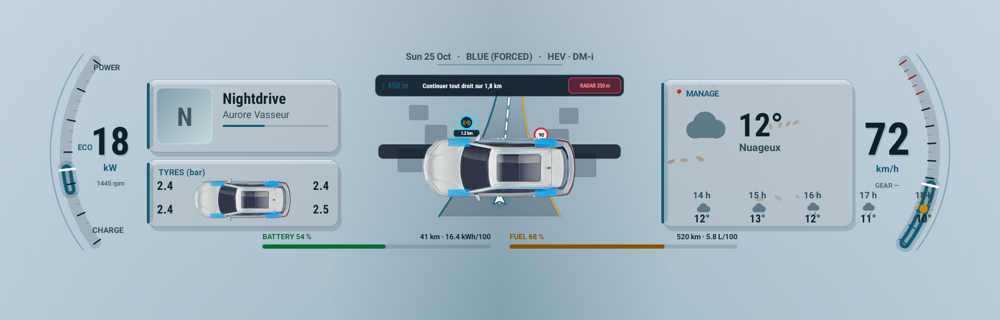

# V E K T R A

**BYD gösterge paneliniz, sizin tarzınızda.**

BYD DiLink 3 araçlarda direksiyon arkasındaki ekran için özel gösterge paneli.

**SÜRÜM 2.3.0** · yayın tarihi 3 Kasım 2026 · 46.4 MB

[**Uygulamayı indir**](https://giino01.github.io/Vektra/Vektra-2.3.0.apk) · [**Proje sayfası**](https://giino01.github.io/Vektra/)

[Français](README.md) · [English](README.en.md) · [Italiano](README.it.md) · [Deutsch](README.de.md) · [Português](README.pt.md) · **Türkçe**

---

## Genel bakış

Soldan sağa: tarih, 220 km/s'e kadar bölümlenmiş **ibreli hız göstergesi**, hangi uygulama çalarsa çalsın **çalan parça**, moda göre seçilen üç değer, batarya boşalırken kırmızı sağa, dolarken yeşil sola giden **enerji akış çizgisi**, ardından **hareketli hava durumu** ve dört **lastiğin basıncı** (bar).

Sport modunda ortam kırmızıya döner, bir `SPORT` rozeti belirir ve alttaki üç değer değişir: tüketim ve batarya yerine güç, motor devri ve gaz pedalı konumu.

> Bu sayfadaki görüntüler her yayında **yayınlanan sürümün kodu tarafından çizilir**, örnek değerlerle. Dolayısıyla burada sunulandan eski bir sürümü gösteremezler.

## Temalar

**Tema** tuşu **Theme Store**'u açar ve yüklü temalar arasında geçiş yapar. **Carbone 3D** yerleşik varsayılan, **VektraUI** diğer yerleşik temadır; **Aston** teması tek dokunuşla indirilir. Seçim hatırlanır ve açılışta geri gelir.

Her tema koyu ve açık olarak vardır. Açık arka plan, fotoğraf üzerinden ölçülen BYD arayüzünün mavi-grisini alır; böylece uygulama üstüne oturmak yerine içine karışır. **Görünüm** ayarı birini, diğerini seçer ya da tableti izler.

## Gerekenler

- **DiLink 3'lü bir BYD** (Android 10). Seal U DM-i üzerinde geliştirildi; diğer DiLink 3 modelleri doğrulanmadı.
- Tablet, **dışarıdan uygulama kurulumunu** kabul etmelidir (sideload).
- Tablette **ağ üzerinden ADB hata ayıklama** etkin, 5555 numaralı bağlantı noktası. VEKTRA buna tabletin kendi üzerinden yerel olarak bağlanır — araçtan hiçbir şey dışarı çıkmaz.
- Hava durumu ve güncellemeler için tablette internet bağlantısı. Geri kalan her şey çevrimdışı çalışır.

**Neden ADB.** Gösterge ekranını serbest bırakan komutlara yalnızca Android'in `shell` kullanıcısı yetkilidir. Sıradan bir uygulama bunları gönderemez. VEKTRA bu nedenle bu yetkiyi almak için tabletin kendi ADB'sini yerel olarak kullanır.

## Kurulum

1. Uygulama dosyasını bu sayfadan tablete indirin.
2. Açın ve kurulumu onaylayın. Android reddederse kullandığınız dosya yöneticisi için "bilinmeyen kaynaklar"a izin verin.
3. VEKTRA'yı açın. İlk açılışta karşılama ekranı dili sorar.
4. **Devam**'a dokunun. Ana ekran açılır.
5. Gönderilen ilk komut **"USB hata ayıklamaya izin verilsin mi?"** sorusunu getirir. **Her zaman izin ver**'i işaretleyip onaylayın. Bu yalnızca bir kez çıkar.

Altı dil mevcut: Fransızca, İngilizce, İtalyanca, Almanca, Brezilya Portekizcesi ve Türkçe.

## Göstergeyi açmak

1. **Kontrol** bölümünde **Denetle · ADB ve tanılama**'ya dokunun. Hata ayıklama iznini bu tetikler ve bağlantının çalıştığını doğrular.
2. **Gösterge**'ye dönün ve **Göstergede göster**'e dokunun.
3. Fabrika göstergesi uykuya geçer, sanal gösterge ekranı oluşturulur, ardından VEKTRA orada görünür. İşlem yaklaşık on saniye sürer.
4. Tabletin ortasındaki önizleme, direksiyon arkasında çizileni canlı gösterir. **Önizleme** düğmesi, durum tablosunu tercih ederseniz bunu kapatır.

**Geri dönmek için** **Özgün haline döndür**'e dokunun: BYD göstergesi yeniden devralır. Dönmezse kontağı kapatıp açın.

## Sol şerit

| Bölüm | Ne işe yarar |
| --- | --- |
| **Gösterge** | Canlı önizleme, görüntüleme düğmesi, ekran, mod ve tema seçimi. |
| **Kontrol** | Algılanan donanımın tam dökümü, hepsini kopyalamak için bir düğmeyle. |
| **Günlük** | Gönderilen her komut ve alınan her yanıt. |
| **Ayarlar** | Dil, görünüm, otomatik başlatma, müzik erişimi, güncellemeler, hava durumu. |

## Müzik

Çalan parçayı göstermek için VEKTRA'nın **bildirim erişimine** ihtiyacı vardır: ses oturumlarını okumak için Android'in kuralı budur. **Bildirim erişimi** satırına dokunun; uygulama bunu mevcut listeden hiçbir şey silmeden ADB üzerinden kendine verir. Verildikten sonra başlık, sanatçı, kapak ve ilerleme, **hangi uygulama çalarsa çalsın** görünür — radyo, Bluetooth ya da kurulu bir uygulama.

## Otomatik başlatma ve durdurma

Bu ayar açıkken VEKTRA, araç çalıştırılır çalıştırılmaz göstergeyi alır ve kapatılır kapatılmaz geri verir. Araç durumu **doğrudan araçtan**, saniyede bir okunur: 0 kapalı, 1 aksesuar, 2 kontak açık. Ekranın geri verilmesi için kapanmanın arka arkaya iki kez doğrulanması gerekir — tek bir kesinti yolda göstergeyi kaybettirmemelidir.

## Görünüm

Koyu, açık veya otomatik — görünüm o zaman tableti izler. Ayar yalnızca göstergeyi ilgilendirir: tablet ekranı her koşulda koyu kalır, orası bir kokpittir.

## Güncelleme

VEKTRA her açılışta kendisi denetler. Bir sürüm mevcut olduğunda bir pencere yenilikleri gösterir ve **Daha sonra** ya da **İndir ve kur** seçeneklerini sunar. Kabul ederseniz uygulama kendini indirir, üzerine kurar ve kendiliğinden yeniden açılır. Tüm sürümler **aynı imzayı** taşır: bir güncelleme, Android reddetmeden ve ayarlar kaybolmadan her zaman öncekinin yerine geçer.

## Bir sorun olursa

- **Gösterge donuk kalıyor.** *Özgün haline döndür*'e dokunup yeniden deneyin. Değişmezse kontağı kapatıp açın.
- **Veri yok, yalnızca tire.** Aracın SDK'sı yanıt vermedi. Kontrol bölümü hangi aygıtlara ulaşılabildiğini söyler.
- **Müzik görünmüyor.** Bildirim erişimi verilmemiş: yukarıya bakın. Ayrıca gerçekten bir şey çaldığını doğrulayın.
- **Güncelleme "Kullanılamıyor" diyor.** Tablet kaynağa ulaşamadı. İnternet bağlantısını denetleyip yeniden deneyin: kesin neden görüntülenir.
- **Başka bir şey.** *Kontrol*'ü açın, *Taramanın tamamını kopyala*'ya dokunun ve metni gönderin. Anlamak için gereken her şeyi içerir.

## Yenilikler: 2.3.0

- Ajout : plusieurs demandes dans une seule phrase — « ferme les vitres et mets la clim à 21 et allume mon siège ».
- Ajout : se reprendre sans tout répéter — « ouvre l'arrière droite… non, l'arrière gauche ».
- Ajout : actions différées — « dans 10 minutes, ferme les vitres ».
- Ajout : rappels — « rappelle-moi de prendre le colis en arrivant ».
- Ajout : règles dictées à la voix — « s'il pleut, ferme les vitres ».
- Ajout : mémoire des habitudes, qui te rappelle ce que tu demandes souvent au même moment.
- Ajout : recherche d'une borne de recharge à la voix, avec guidage lancé dans ton application de navigation.
- Ajout : questions sur la voiture — un bouton, un témoin au tableau de bord, le réglage d'une fonction.
- Ajout : mode explique-moi, qui déroule une manipulation une étape à la fois.
- Ajout : traduction à la voix, prononcée dans la bonne langue.
- Ajout : calculs, pourcentages et conversions traités sans réseau.
- Ajout : réponses de recherche résumées en deux phrases.
- Ajout : histoires pour les enfants et quiz en famille sur les longs trajets.
- Ajout : coach d'éco-conduite à la demande, avec un seul conseil à la fois.
- Ajout : caractère de l'assistant au choix — minimal, équilibré ou chaleureux.
- Ajout : réponse dans la langue du passager qui parle, en option.
- Ajout : alerte brouillard du copilote.
- Ajout : rappel des feux quand la lumière baisse en roulant.
- Ajout : annonce du passage hors-ligne et du retour du réseau.
- Ajout : ligne « En attente » dans les réglages, pour voir et effacer ce qui est programmé.
- Correctif : la voix sort désormais du haut-parleur de l'appui-tête conducteur pour tout le monde.
- Correctif : réglages allégés — l'intro de projection, la cadence de lecture, la sortie audio et l'accès aux notifications ont quitté la page.

---

Kişisel bir proje, BYD ile hiçbir bağlantısı yoktur. Kurulum ve kullanım kendi sorumluluğunuzdadır. Gösterilen bilgiler aracın sisteminden gelir ve yanlış olabilir: araç kullanırken asla bunlara güvenmeyin.
